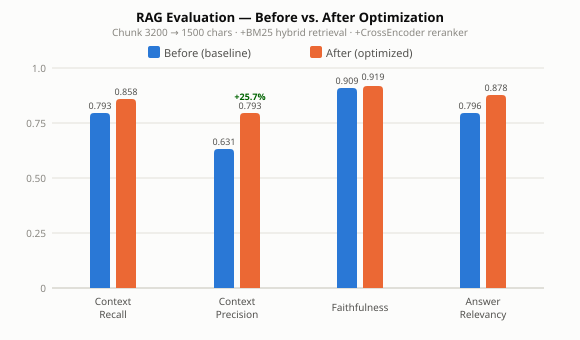

# AskDatasphere

A RAG-based Q&A system built on official SAP Datasphere documentation, featuring a Chunk Browser and a Q&A page.

## Tech Stack

| Layer | Technology |
|---|---|
| Frontend | OpenUI5 1.120 (CDN, no build step) |
| Backend | FastAPI + uvicorn |
| Vector store | Chroma (local persistent) |
| Embedding model | BAAI/bge-base-en-v1.5 (via ModelScope) |
| Retrieval strategy | Dense (Chroma) + BM25 (rank_bm25) → RRF fusion → CrossEncoder reranking |
| Reranker | BAAI/bge-reranker-base (via ModelScope) |
| Generation model | Anthropic Claude (claude-sonnet-4-5) |
| Evaluation | RAGAS (Claude as judge, bge for embeddings) |

## Directory Structure

```
AskDatasphere/
├── backend/
│   └── main.py          # FastAPI: /api/chunks, /api/ask, static file hosting
├── frontend/
│   ├── index.html       # UI5 CDN bootstrap
│   ├── manifest.json    # UI5 routing config
│   ├── Component.js     # UIComponent root
│   ├── view/
│   │   ├── Shell.view.xml    # Root view with NavContainer
│   │   ├── Chunks.view.xml   # Chunk browser page
│   │   ├── Chat.view.xml     # Q&A page
│   │   └── Eval.view.xml     # Eval report page
│   └── controller/
│       ├── Shell.controller.js
│       ├── Chunks.controller.js
│       ├── Chat.controller.js
│       └── Eval.controller.js
├── rag/
│   ├── ingest.py                  # One-time script: PDF → Chroma
│   ├── gen_eval_dataset.py        # Sample chunks, generate Q&A pairs with Claude
│   ├── run_eval.py                # Run real RAG pipeline, fill in answers and retrieved contexts
│   ├── evaluate.py                # Score results with RAGAS
│   └── __init__.py
├── pdfs/                # Official SAP Datasphere PDFs (in .gitignore, download separately)
├── chroma_db/           # Chroma vector store (generated by ingest)
├── RAG_OPTIMIZATION.md  # RAG quality optimization: completed work and future directions
└── pyproject.toml
```

## Setup

```bash
python -m venv .venv
source .venv/bin/activate   # Windows: .venv\Scripts\activate
pip install -e .            # Core runtime dependencies
pip install -e ".[eval]"    # Also needed for evaluation (RAGAS + langchain)
```

`.env` file (place in project root):

```
ANTHROPIC_API_KEY=your_key_here
ANTHROPIC_BASE_URL=http://localhost:6655/anthropic   # Company internal proxy
```

## Building the Vector Store

Run once:

```bash
python -m rag.ingest
```

Reads all PDFs from `pdfs/`, extracts plain text (title taken from embedded PDF metadata when available, otherwise extracted from the first page between "Document Version" and "©"), chunks at 1500 characters (200 overlap, ~375 tokens, within the embedding model's 512-token limit), and writes to `chroma_db/`. Re-running is idempotent — existing chunks are skipped.

## Starting the Server

```bash
python -m uvicorn backend.main:app --reload --host 0.0.0.0 --port 8000
```

Open `http://localhost:8000`. On startup the server preloads the embedding model and reranker, and builds a BM25 inverted index by pulling all chunks from Chroma into memory. First startup takes ~30–60 seconds.

## Features

### Chunk Browser

Browse all document chunks stored in Chroma by index range (Start / End), with full text view.

### Q&A Page

- Left column: enter a question → Ask → see Claude's answer
- Right column: retrieved Top K chunks + the full prompt sent to Claude
- Top K is adjustable on the page (default 5, max 20)
- Retrieval uses a hybrid strategy: Dense (Chroma vector search) and BM25 each retrieve 20 candidates, merged via RRF into Top 10, then reranked by a CrossEncoder to return Top K

### Eval Report Page

Upload `eval_scores.csv` (generated by `python -m rag.evaluate`) to see:

- Four metric score cards at the top (Context Recall / Context Precision / Faithfulness / Answer Relevancy), color-coded green ≥ 0.75, yellow ≥ 0.50, red < 0.50
- Per-question table with all four scores, sortable by any metric (ascending / descending)
- Click any row to open a detail dialog with the full question, system answer, ground truth, and individual scores

## Evaluating RAG Quality

Score retrieval and generation separately with RAGAS (Claude as judge, local bge for embeddings — no OpenAI dependency). Three steps:

```bash
# 1. Build test set: sample chunks, generate Q&A pairs → eval_dataset.jsonl
python -m rag.gen_eval_dataset --sample 200

# 2. Run real RAG: fill in system answers and retrieved contexts → eval_runs.jsonl
python -m rag.run_eval --limit 50          # small run first; omit --limit for full run

# 3. Score: output four metrics → eval_scores.csv (per-question) + eval_summary.json (aggregate)
python -m rag.evaluate --limit 50          # --limit must match the previous step
```

Output: `eval_scores.csv` has one row per question with retrieved contexts, system answer, ground truth, and four individual scores — useful for identifying low-scoring cases. `eval_summary.json` contains the run parameters (sample count, judge/embedding models, timestamp) and the four aggregate means.

The four metrics split into two groups: Context Recall and Context Precision measure retrieval quality; Faithfulness and Answer Relevancy measure generation quality. All four are better closer to 1. How each is computed (see [EVAL_LOG.md](EVAL_LOG.md) for historical results and [RAG_OPTIMIZATION.md](RAG_OPTIMIZATION.md) for optimization directions):

| Metric | Measures | How it's computed |
|---|---|---|
| **Context Recall** | Whether retrieval found the necessary information | Judge LLM decomposes `ground_truth` into individual claims, checks each against `retrieved_contexts`, reports the coverage ratio |
| **Context Precision** | Whether retrieved chunks are relevant and well-ranked | Judge LLM decides whether each retrieved chunk is genuinely useful for answering `ground_truth`, then weights by rank — useful chunks ranked higher score better |
| **Faithfulness** | Whether the answer fabricates anything | Judge LLM extracts all factual claims from `answer`, checks each against `retrieved_contexts`, reports the supported ratio |
| **Answer Relevancy** | Whether the answer is on-topic | Embedding model reverse-generates candidate questions from `answer`, computes cosine similarity to the original `question`; does not require `ground_truth` |

> Evaluation has heavy dependencies (RAGAS + langchain). Run `pip install -e ".[eval]"` first. langchain 1.x is incompatible with RAGAS 0.2.x; pinned versions are in the `eval` extra in pyproject.toml.

## RAG Optimization

Analysis of completed optimizations and future directions (chunk strategy, hybrid retrieval, reranking, hallucination mitigation, Graph RAG, Agentic RAG) is in [RAG_OPTIMIZATION.md](RAG_OPTIMIZATION.md).

---

## Source Documentation

This project's corpus comes from the [SAP Help Portal — SAP Datasphere](https://help.sap.com/docs/SAP_DATASPHERE), all publicly available without login.

### Document Sources

All content comes from the official PDFs downloaded via each section's "Download PDF" link (`pdfs/`, in `.gitignore`, not distributed with the repo — download separately). Ingest extracts the real title from each PDF as the deliverable. Currently covers:

- Acquiring, Preparing, and Modeling Data with SAP Datasphere
- Administering SAP Datasphere
- Accessing SAP Datasphere via the Command Line
- Consuming Data Exposed by SAP Datasphere
- Data Sharing Cockpit - Data Providers Guide
- Feature Scope Description - SAP Datasphere
- Getting Started with SAP Datasphere
- Getting Started With SAP Datasphere, SAP BW Bridge
- Governing and Publishing Data in the Catalog
- Integrating Data and Managing Spaces in SAP Datasphere
- SAP Datasphere Business Content
- SAP Datasphere Security Recommendations
- Security Guide
- What's New in SAP Datasphere

### Version Note

SAP Datasphere documentation is updated continuously. Re-downloading the PDFs will yield versions that differ from what this repo currently uses (added, changed, or removed pages). The chunks in this repo are based on the document version at the time of download and are not guaranteed to match the latest release.

---

## Evaluation Log



All evaluation runs — parameters, results, analysis, and improvement plans — are recorded in [EVAL_LOG.md](EVAL_LOG.md). Metric computation details are in the "Evaluating RAG Quality" section above; optimization directions are in [RAG_OPTIMIZATION.md](RAG_OPTIMIZATION.md).
